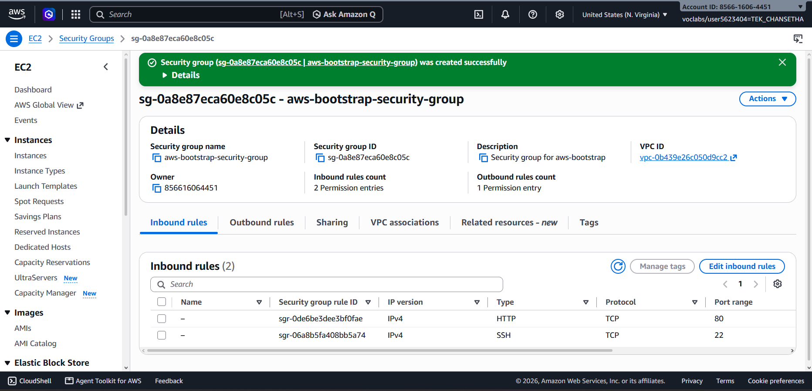
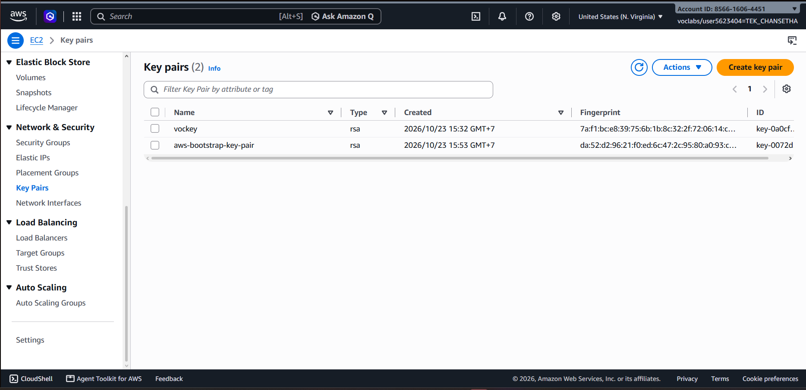
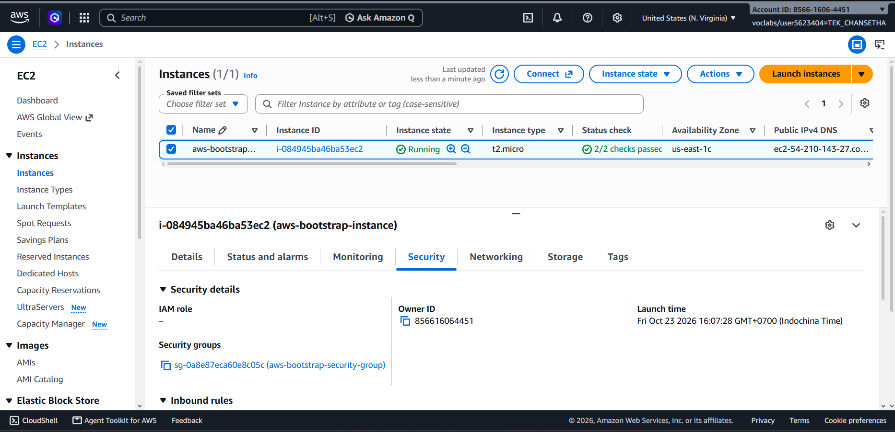
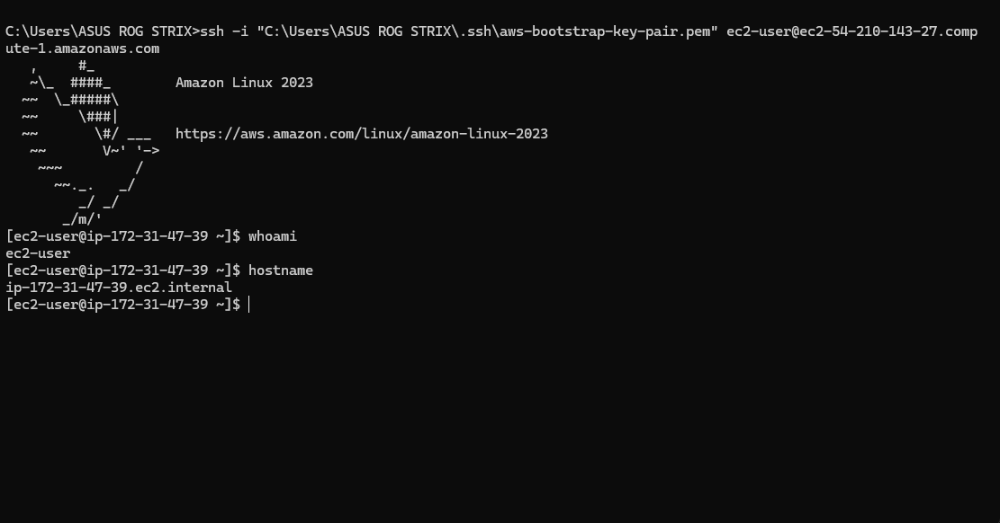
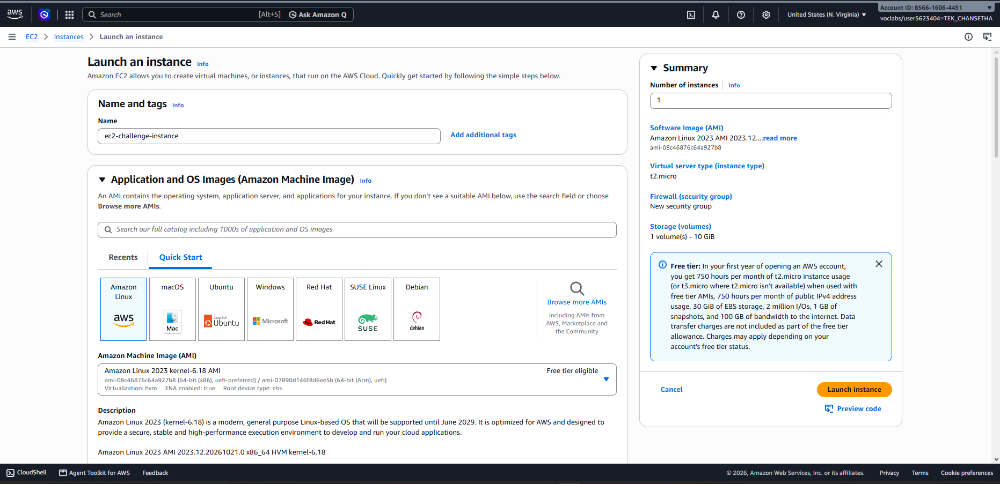
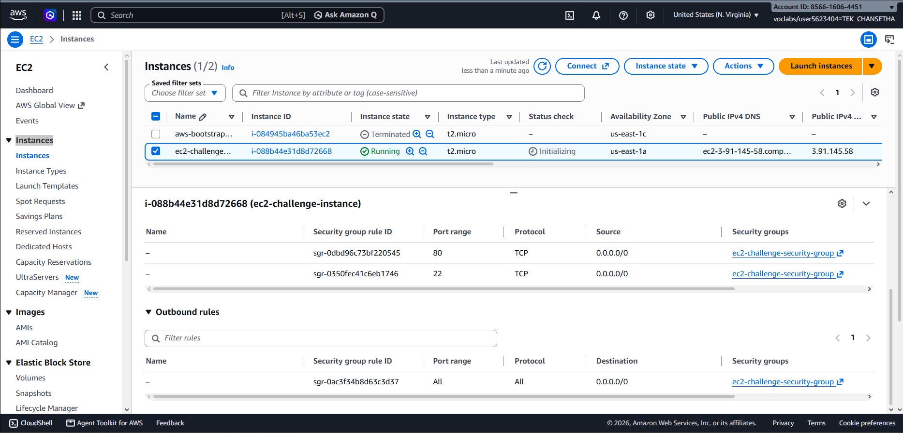
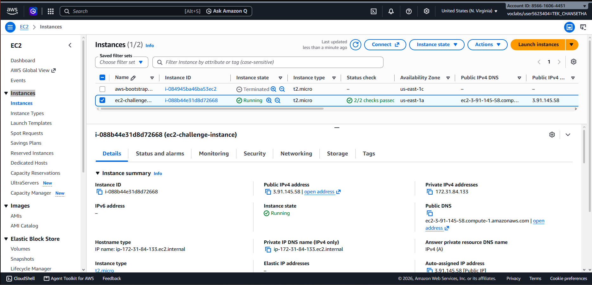
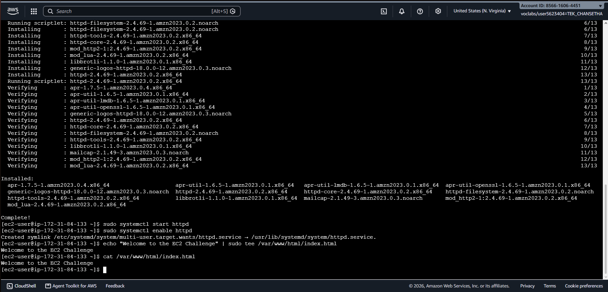
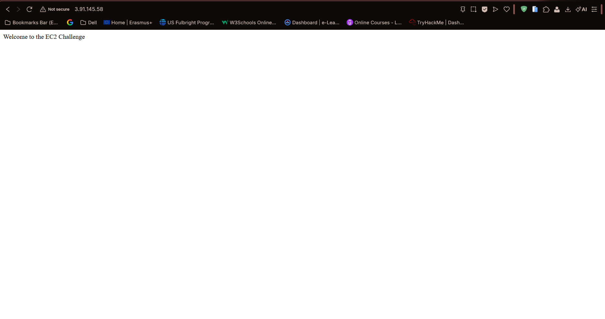

# Cloud Lab 1 Submission — Amazon EC2

- **Student name:** TEK Chansetha
- **Student ID:** e20220186
- **Learner Lab user name:** voclabs/user5623404=TEK_CHANSETHA
- **Date completed:** 23 October 2026

---

## Part 1.1 — An Amazon EC2 Walkthrough

### Security group



### Key pair



### Instance details



### Browser test


### SSH connection



Did you connect with your own SSH client or with EC2 Instance Connect?

---

## Part 1.2 — EC2 Web Solution (Challenge)

### Launch configuration



### Security group



### Running instance



### Commands on the instance



Paste the commands you ran to install the web server and create `index.html`:

```bash
sudo dnf update -y
sudo dnf install httpd -y
sudo systemctl start httpd
sudo systemctl enable httpd
echo "Welcome to the EC2 Challenge" | sudo tee /var/www/html/index.html
cat /var/www/html/index.html
```

### Browser test



---

## Questions

### 1. Your security group has an SSH rule and an HTTP rule. What does each one let you do? What would stop working if you deleted the HTTP rule?
- The SSH rule allows connections to the EC2 instance on port 22, which is used for remote administration through SSH. The HTTP rule allows web traffic on port 80 so that users can access the website hosted on the instance. If the HTTP rule were deleted, the EC2 instance could still run Apache, but the web page would no longer be accessible from a browser through the public IP address.


### 2. In Part 1.1 you never logged in to install the web server. What installed it, and when did it run?
- The web server was installed automatically by the user data script configured when the EC2 instance was launched. The script ran during the first boot of the instance and installed Apache, started the service, enabled it at startup, and created the index.html file.


### 3. Why does the web page open with `http://` but not with `https://`?
- The web page works with http:// because Apache is serving the website on HTTP port 80 and the security group allows HTTP traffic. HTTPS does not work because HTTPS was not configured on the web server. There is no SSL/TLS certificate configured for Apache, and the security group does not allow HTTPS traffic on port 443.


### 4. Part 1.2 asked for a 10 GiB root volume. Where in the launch settings did you set it, and how can you check the size on the running instance?
- I configured the root volume in the Configure storage section while launching the EC2 instance. I changed the root EBS volume size to 10 GiB and kept the volume type as gp3. The configured storage size can be checked from the running EC2 instance by selecting the instance and opening the Storage tab. The attached EBS root volume and its size are shown there.


## Problems and how I solved them

While creating the instance in Part 1.1, I accidentally launched it as a t2.nano instead of the required t2.micro. I stopped the instance, changed the instance type to t2.micro, and started it again. After the instance passed the status checks, I verified that the correct instance type was displayed before continuing.


## AI note

An AI tool suggested checking the instance type carefully before using the screenshot as evidence. I verified the configuration directly in the AWS EC2 console and found that the instance was using t2.nano instead of the required t2.micro. I corrected it in AWS and confirmed that the instance showed t2.micro before taking the final screenshot.


## Clean up

- [x] Part 1.1: instance terminated, key pair and security group deleted.
- [x] Part 1.2: instance terminated, security group (and key pair, if any) deleted.