# Cloud Lab 2 Submission — Load Balancer and Auto Scaling

- **Student name:** TEK Chansetha
- **Student ID:** e20220186
- **Learner Lab user name:** voclabs/user5623404=TEK_CHANSETHA
- **Date completed:** 30/10/2026

---

## Security groups

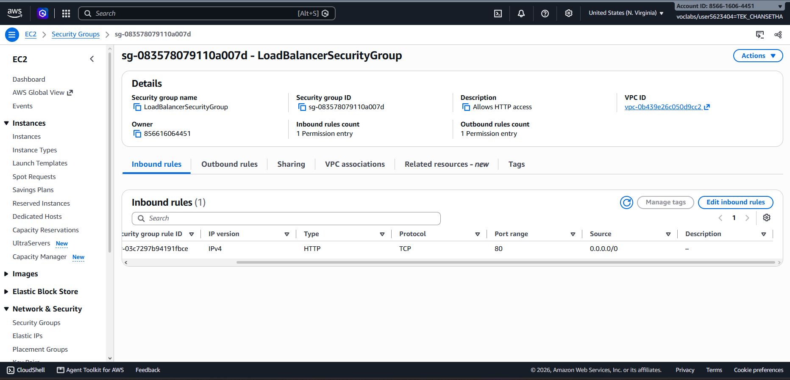

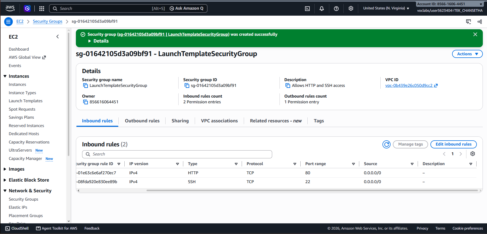

## Target group

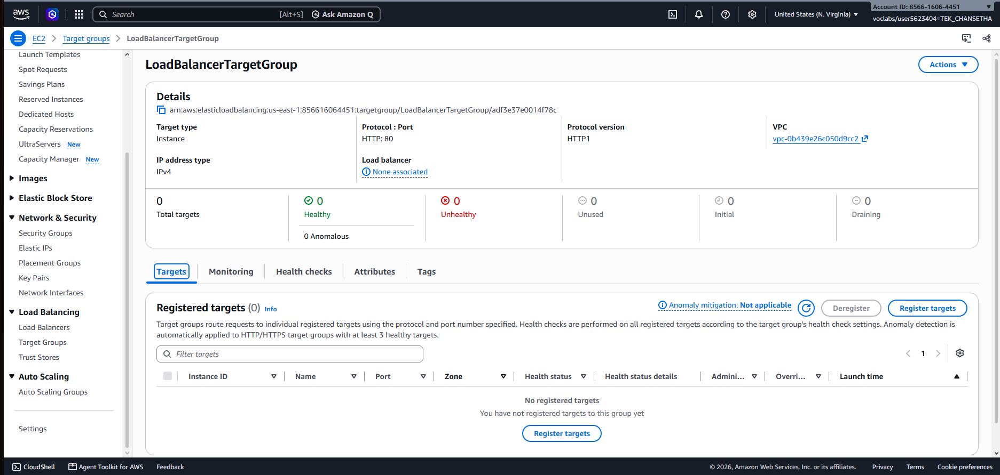

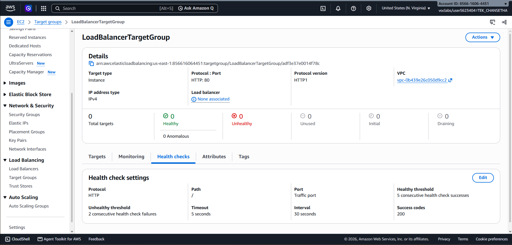

## Application Load Balancer

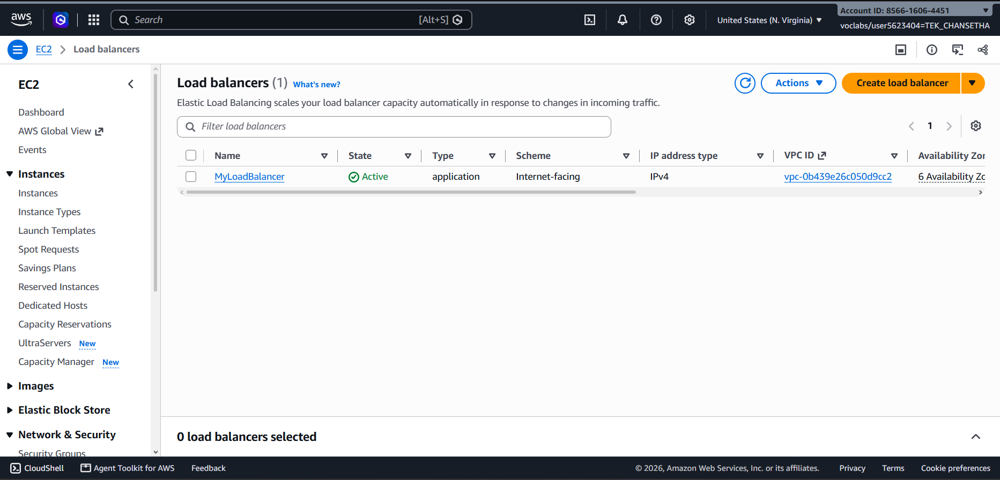

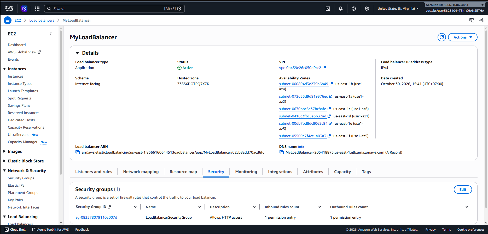

## Launch template

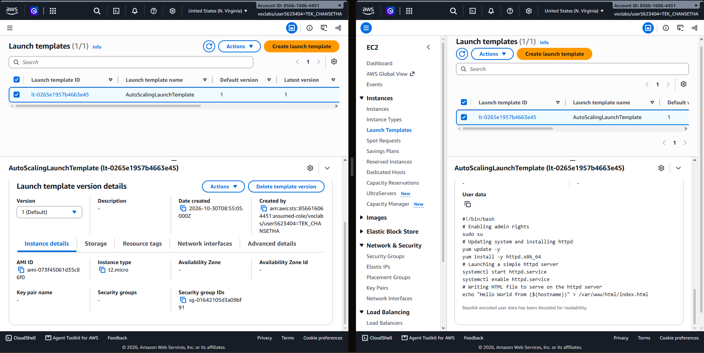

## Auto Scaling group

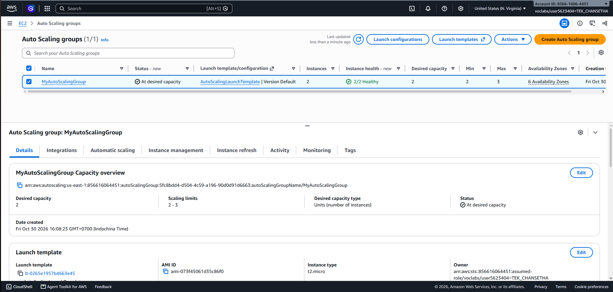

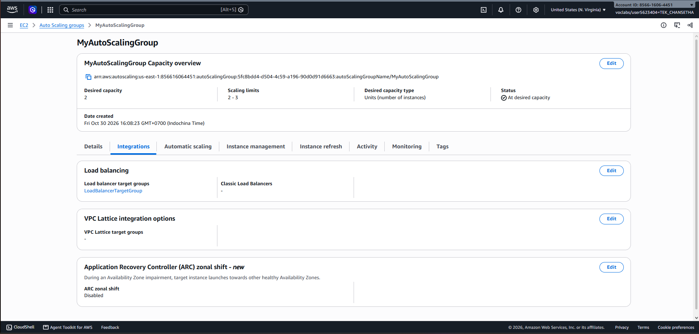

## Load balancing test


## Simulated application failure

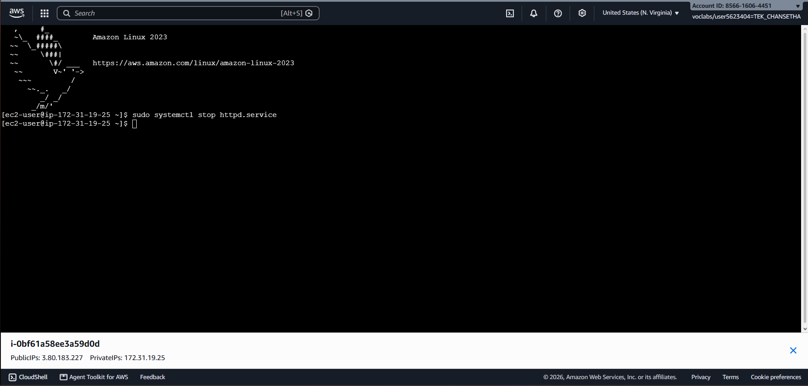

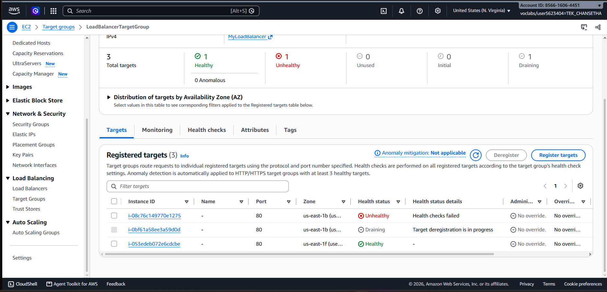

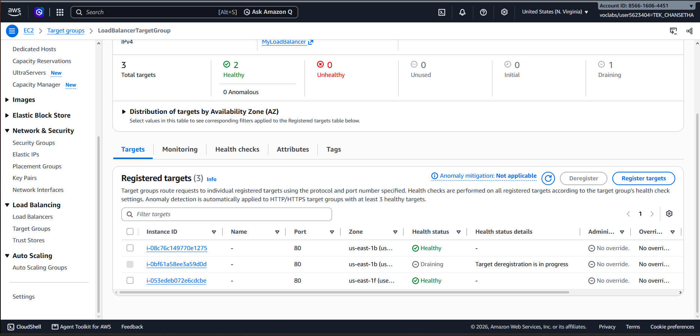

About 6 minutes passed between stopping httpd and the new instance becoming healthy. I stopped httpd at approximately 4:47 PM, and the replacement instance became healthy at approximately 4:53 PM.

---

## Questions

### 1. Why does the page show a different host name when you refresh it?
The page shows a different host name because the Application Load Balancer distributes requests between the healthy EC2 instances in the target group. Each instance has its own host name, so when I refreshed the page, the load balancer sometimes sent the request to a different instance.

For example, during my test I received responses from different hosts while using the same load balancer DNS name.


### 2. After you stopped `httpd`, the instance was still *running* in EC2, but the target group marked it *unhealthy*. What did the health check test, and why did the instance fail it?
The health check tested whether the web application was responding correctly through HTTP on port 80 using the path /.

The EC2 instance itself was still running, but I stopped the httpd web server. Because there was no web server responding correctly to the HTTP request, the health checks failed. After the required failed health checks, the target group marked the instance as unhealthy.

This shows that an EC2 instance can still be running while the application inside it is not working.


### 3. Who replaced the failed instance: the load balancer, the target group, or the Auto Scaling group? Explain the role of each one.
The Auto Scaling group replaced the failed instance.

- The Application Load Balancer receives requests from users and sends them to healthy instances.

- The target group keeps track of the registered instances and performs health checks on them.

- The Auto Scaling group maintains the required number of instances. When the failed instance was detected as unhealthy, the Auto Scaling group launched a new instance to replace it.

During my test, I could see the failed instance enter the Draining state while a new instance was launched and later became Healthy.


### 4. With desired 2, minimum 2 and maximum 3, how many instances run normally? In what situation could there be 3?
Normally, 2 instances run because the desired capacity is 2.

The minimum capacity is also 2, so the Auto Scaling group should maintain at least two instances. The maximum capacity is 3, so the group is allowed to have up to three instances.

There can temporarily be 3 instances during a replacement or scaling operation. I observed this during the failure test when the old instance was being removed while the Auto Scaling group launched a replacement instance.


### 5. The instances' security group allows HTTP from anywhere. How could you change it so that the instances accept HTTP **only** from the load balancer?
I would change the HTTP inbound rule of LaunchTemplateSecurityGroup.

Instead of allowing:
```
Type: HTTP
Port: 80
Source: 0.0.0.0/0
```

I would set the source to:

```
Type: HTTP
Port: 80
Source: LoadBalancerSecurityGroup
```
This would allow HTTP traffic to the EC2 instances only when it comes from the Application Load Balancer. Direct HTTP access from the internet to the backend instances would no longer be allowed.


## Problems and how I solved them (optional)
One thing I noticed during the failure test was that the replacement instance did not become healthy immediately. After stopping httpd, the target group first detected the failed health checks and the old instance entered the Draining state.

The Auto Scaling group then launched a new instance. At first, the replacement target was also shown as Unhealthy because it was still starting and running the user data script. After the web server finished installing and starting, the health checks succeeded and the replacement instance became Healthy.

I solved this by monitoring the target group and waiting for the new instance to finish its initialization instead of changing the configuration.
## AI note (optional)

An AI tool suggested checking the target group health status after stopping httpd instead of only checking the EC2 instance state.

I verified this directly in the AWS console. The EC2 instance was still shown as running, but the target group marked the application as unhealthy because its HTTP health checks failed. I also observed the Auto Scaling group launch a replacement instance, which later became healthy.


## Clean up

- [x] `MyAutoScalingGroup` deleted and its instances terminated.
- [x] `AutoScalingLaunchTemplate` deleted.
- [x] `MyLoadBalancer` and `LoadBalancerTargetGroup` deleted.
- [x] Both security groups deleted.