# Cloud Lab 4 Submission — Amazon VPC
- **Student name:** TEK Chansetha
- **Student ID:** e20220186
- **Learner Lab user name:** voclabs/user5623404=TEK_CHANSETHA
- **Date completed:** 13/11/2026

---

## VPC and internet gateway

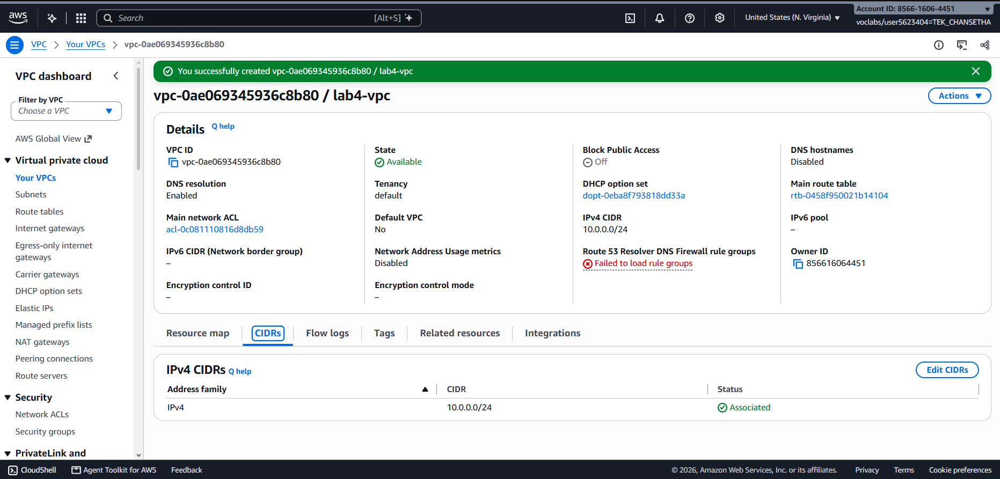

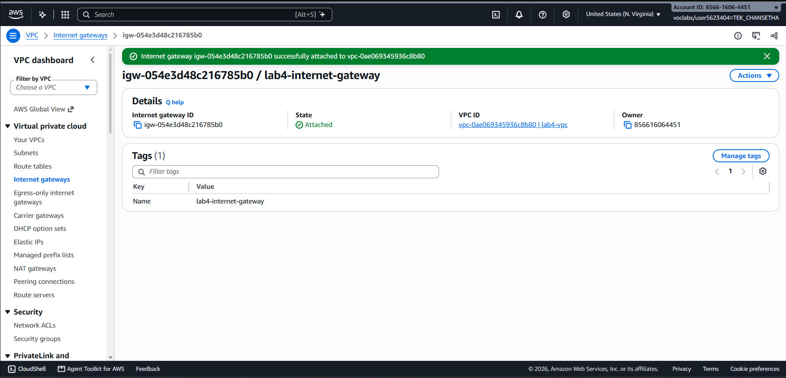

## Public subnet

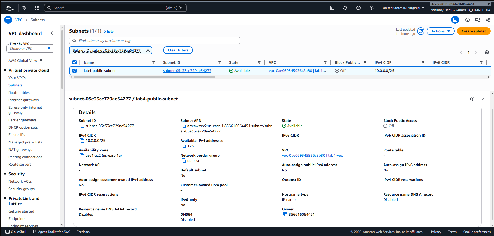

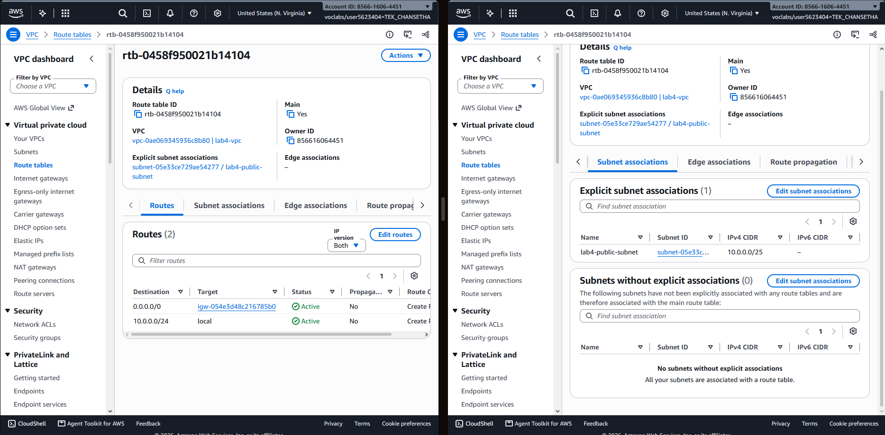

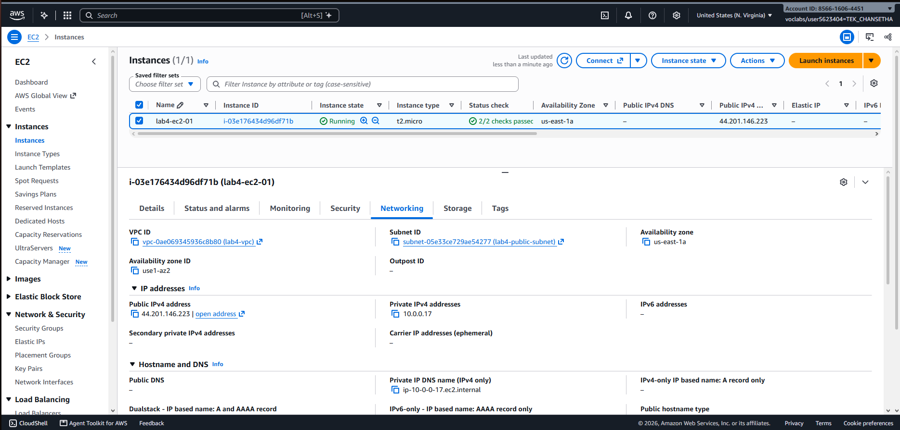

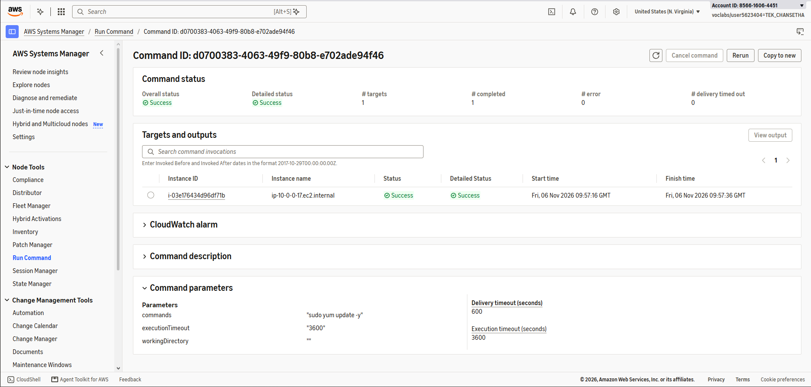

## Private subnet

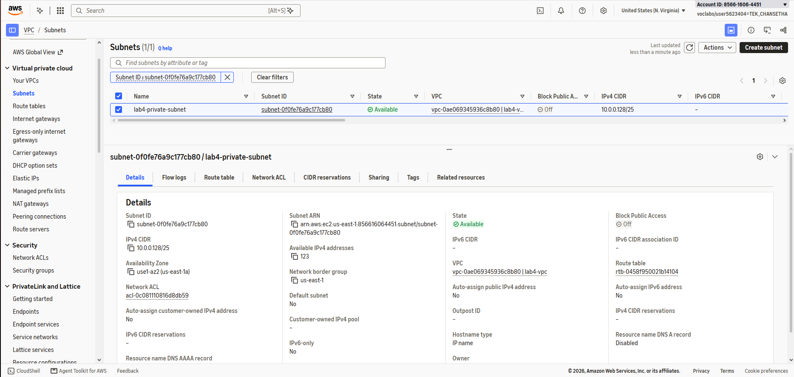

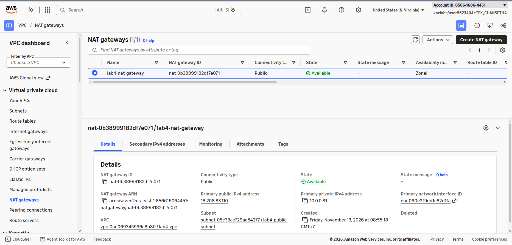

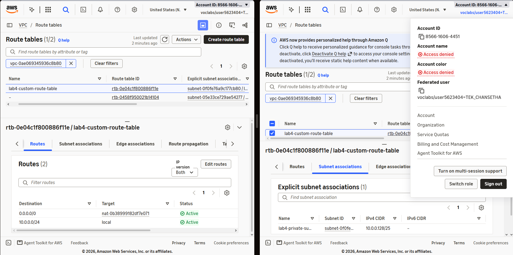

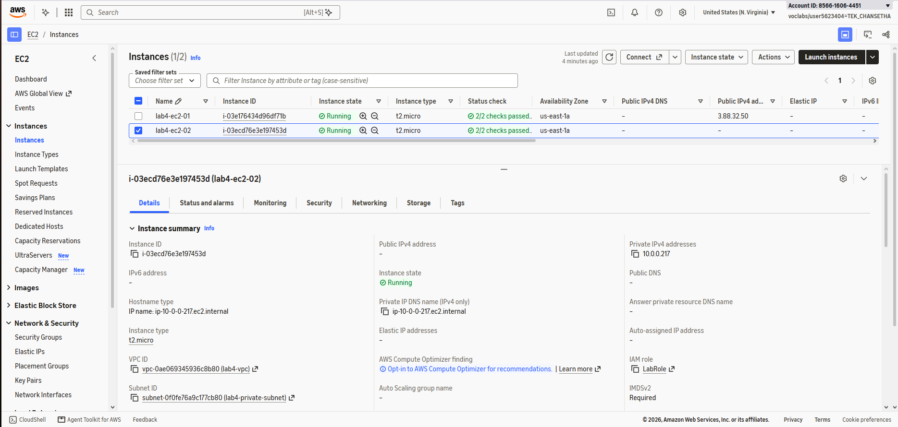

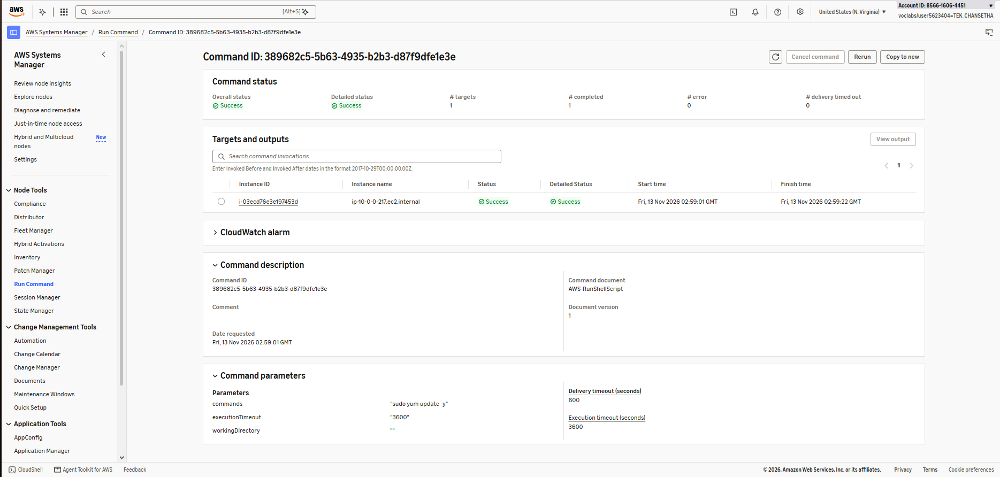

---

## Questions

1. The VPC is `10.0.0.0/24` and the subnets are `10.0.0.0/25` and `10.0.0.128/25`. How many IP addresses does each block contain, and why do the two subnets not overlap?
   - The VPC 10.0.0.0/24 contains 256 IP addresses. Each /25 subnet contains 128 IP addresses, but AWS reserves five addresses per subnet, leaving 123 usable addresses. The subnets do not overlap because they use different, consecutive IP address ranges. Together, they cover the entire VPC CIDR block.
     - Public subnet 10.0.0.0/25: 10.0.0.0 to 10.0.0.127
     - Private subnet 10.0.0.128/25: 10.0.0.128 to 10.0.0.255

2. Both subnets are in the same VPC. What exactly makes `lab4-public-subnet` public and `lab4-private-subnet` private?
   - The main difference is their route table configuration. The public subnet has a default route (0.0.0.0/0) pointing to the Internet Gateway, allowing instances with public IP addresses to communicate directly with the internet, subject to security rules. The private subnet has a default route pointing to the NAT Gateway instead of the Internet Gateway. This allows instances to initiate outbound internet connections without being directly accessible from the internet.

3. Why is the NAT gateway placed in the **public** subnet and not in the private one?
   - A public NAT Gateway must be placed in a public subnet because it needs a route through the Internet Gateway and an Elastic IP address to communicate with the internet. The private subnet sends outbound traffic to the NAT Gateway, which translates the source IP address and forwards the traffic to the internet. Return traffic is then forwarded back to the private instance. If the NAT Gateway were placed in a private subnet without a route to the Internet Gateway, it could not provide the required internet connectivity.

4. `lab4-ec2-02` has no public IP address. Can someone on the internet open a connection to it? Can it download updates? Explain both answers.
   - No, someone on the internet cannot directly initiate a connection to lab4-ec2-02 because it has no public IP address, and the NAT Gateway does not allow unsolicited inbound connections. Its security group also has no inbound rules. Yes, the instance can download updates because its private subnet routes outbound internet traffic through the NAT Gateway. This was verified by successfully executing sudo yum update -y using AWS Systems Manager Run Command.

5. You tested internet access with Systems Manager instead of SSH. Why did the instances need `LabInstanceProfile` for this?
   - The instances needed LabInstanceProfile to obtain the IAM permissions required to communicate with AWS Systems Manager. The instance profile provides temporary AWS credentials to the EC2 instances through its associated IAM role, LabRole. These credentials allow the SSM Agent to communicate with Systems Manager, receive commands, and report execution results. Without the required IAM permissions, Systems Manager would not be able to manage the instances properly, even if network connectivity were available. Using Systems Manager also allowed us to execute commands without opening SSH port 22.

## Problems and how I solved them (optional)
During the lab, I encountered several problems:

- **Incorrect private subnet CIDR:** I initially entered 10.0.0.0/25, which was already assigned to the public subnet. I corrected it to 10.0.0.128/25 before creating the private subnet.

- **Extra Elastic IP allocation:** I accidentally allocated two Elastic IP addresses while configuring the NAT Gateway. I kept the address used by the NAT Gateway and released the unused address to avoid unnecessary charges.

- **Systems Manager validation error:** While running the internet connectivity test on the private EC2 instance, AWS displayed a validation error involving the command ID. I reopened Run Command, configured the command again, and successfully executed sudo yum update -y.

- **Internet Gateway detachment error:** During cleanup, AWS initially reported that the NAT Gateway was still available, even though it had been deleted. After refreshing the console and verifying the NAT Gateway's status, I successfully detached and deleted the Internet Gateway.

## AI note (optional)

An AI tool suggested configuring the private subnet's default route (0.0.0.0/0) to point to the NAT Gateway instead of the Internet Gateway.

I checked this suggestion against the lab instructions and verified the route in the AWS VPC Console. I then confirmed that it worked by successfully running sudo yum update -y on the private EC2 instance through Systems Manager.

## Clean up

- [x] Instances terminated.
- [x] NAT gateway deleted and its Elastic IP released.
- [x] Internet gateway detached and deleted.
- [x] `lab4-vpc` deleted.